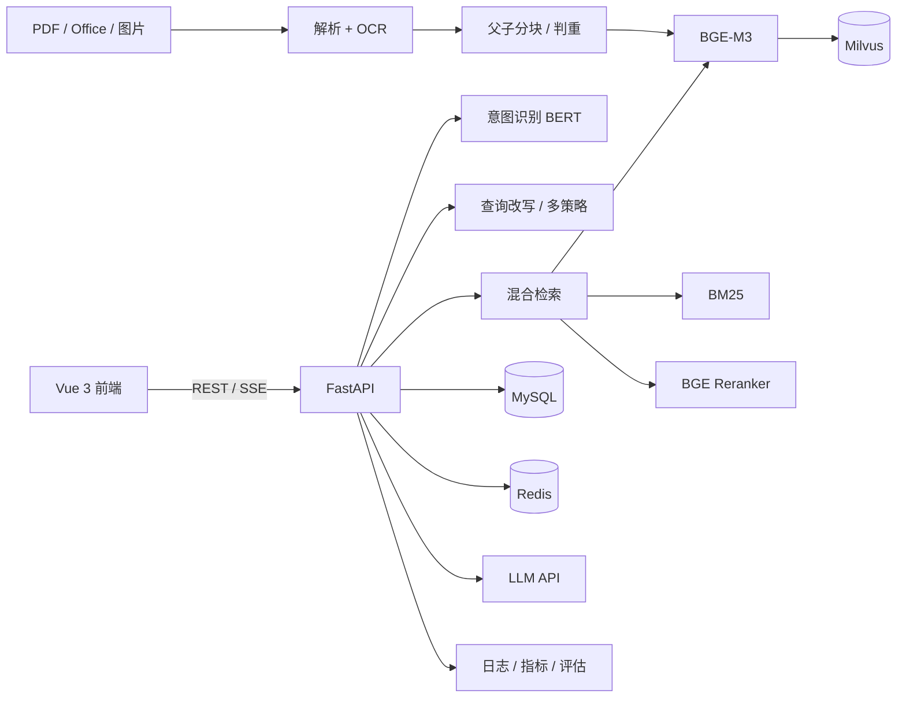

# AskToFit · 售前智能导购

> 面向服装电商售前场景的 RAG 问答系统：多知识库混合检索、重排序、查询理解、SSE 流式回答、文档解析与评估看板。

AskToFit 把「退换货、尺码、面料、发票、物流、会员优惠」等售前资料变成可检索的知识库。用户用自然语言提问，系统检索相关资料并给出带引用的流式回答，同时记录知识缺口，方便运营持续补充内容。

项目采用 **FastAPI + Vue 3 + MySQL + Milvus + Redis**，本地运行 **BGE-M3 / BGE Reranker / 意图 BERT** 模型，适合学习、演示和售前试点。

> **项目定位**：个人全栈项目，默认单机 CPU 部署，不是开箱即用的生产集群。真实容量、压测条件与限制见[性能与容量](#性能与容量)。

---

## 功能亮点

- **混合检索**：BGE-M3 稠密 / 稀疏向量 + 纯 Python BM25，使用 RRF 融合；支持按知识库选择检索范围。
- **查询理解**：查询改写、规则化多策略（直接检索 / 回溯 / HyDE / 子查询），HyDE 文本只参与召回，不进入提示词和引用。
- **父子分块与判重**：父块保留完整上下文，子块用于向量检索；文档与分块做归一化哈希、SimHash 和文本相似度判重，改标点或文件名不会产生重复文档。
- **多格式解析**：PDF、PPT / PPTX、DOC / DOCX、Markdown、PNG / JPG；扫描页和文档内嵌图片自动 OCR；复杂版式可选用 MinerU Docker 深度解析。
- **流式问答**：SSE 输出首 token、引用和结束事件，支持多轮记忆、温度 / top_p / 最大输出等参数。
- **可观测与评估**：Prometheus 指标、知识缺口运营台、检索指标（Hit@K / Recall@K / MRR / NDCG@K）和官方 RAGAS 生成指标。
- **工程化**：Redis 缓存、限流、熔断、检索单飞、持久化入库任务、向量 outbox、Docker 与 GitHub Actions。

## 技术栈

| 层次 | 技术 |
|---|---|
| 后端 | Python 3.13、FastAPI、SQLAlchemy Async、Pydantic |
| 数据 | MySQL 8、Milvus 2.4、Redis |
| 模型 | BGE-M3、BGE Reranker v2-m3、本地意图 BERT、RapidOCR |
| 检索 | 稠密 / 稀疏向量、BM25、RRF、Cross-Encoder 重排序 |
| 前端 | Vue 3、Vite、Pinia、Element Plus、Markdown 渲染 |
| 解析 | PyMuPDF、python-pptx、python-docx、LibreOffice / antiword、MinerU（可选） |
| 测试与运维 | pytest、Vitest、Playwright、Locust、Docker、GitHub Actions |

## 系统架构



## 快速开始

### 1. 准备依赖

- Python **3.13+**、[uv](https://docs.astral.sh/uv/)
- Node.js **20+**
- MySQL 8、Redis、Milvus **2.4.x**（`pymilvus` 固定 2.4.x）
- 本地模型目录：`models/bge-m3`、`models/bge-reranker-v2-m3`、`models/intent-bert`

模型不打进镜像或仓库，需要单独下载并放到上述目录；也可以修改 `.env` 中的 `BGE_M3_PATH`、`BGE_RERANKER_PATH`、`INTENT_MODEL_PATH`。

### 2. 配置

```bash
cp .env.example .env
```

至少填写：

- MySQL / Redis / Milvus 连接信息
- `DEEPSEEK_API_KEY`（或兼容 OpenAI 协议的其他模型服务）
- `JWT_SECRET`（生产环境请使用 32 字节以上的随机值）
- 模型路径

> `.env` 已被 `.gitignore` 忽略。不要提交真实密钥、数据库密码或内部域名。

### 3. 启动后端

```bash
uv sync
uv run uvicorn app.main:app --host 0.0.0.0 --port 8000 --workers 1
```

- 接口文档：<http://127.0.0.1:8000/docs>
- 健康检查：<http://127.0.0.1:8000/api/health>

演示、压测或多人访问时**不要加 `--reload`**：文件变化会重启进程，模型和进程内 BM25 索引都要重新加载。默认单 worker；每个 worker 各持有一份模型，不要随意增加。

### 4. 启动前端

```bash
cd frontend
npm install
npm run dev        # 开发模式，默认 http://127.0.0.1:5173
```

或使用构建产物：

```bash
npm run build
npm run preview    # 同样使用 5173
```

dev 与 preview 共用 5173，不能同时启动。需要绑定自定义域名时，在启动前设置 `VITE_ALLOWED_HOSTS=demo.example.com`；localhost 和局域网 IP 默认允许。

### 5. 导入示例业务文档

先注册并登录一个账号，然后用该账号创建公共知识库：

```bash
# 生成基础业务文档（旧版 .doc 需要本机安装 Microsoft Word）
uv run python scripts/build_business_docs.py

# 导入到指定账号的公共知识库，并做真实检索抽查
uv run python scripts/import_business_docs.py --username <你的账号>
```

`data/business_docs/` 下提供 21 份服装售前文档，覆盖退换货、尺码、面料、发票、物流、会员优惠、异常 SOP、活动海报和旧版 Word 应答卡，包含表格、流程图、尺码图和图片 OCR 场景。其中 9 份基础文档可由 `build_business_docs.py` 重新生成（旧版 `.doc` 需要本机安装 Microsoft Word），另外 12 份为 2026 秋冬补充文档。

### 6. 运行测试

```bash
# 后端
uv run python -m pytest tests/ -v

# 前端
cd frontend
npm run test
npm run build
```

端到端验收需要先启动后端与前端：

```bash
cd frontend
npm run test:e2e
```

## 核心能力

### 文档解析与知识库

- 支持 PDF、PPT / PPTX、DOC / DOCX、Markdown、PNG / JPG。
- PDF 正文过少时按页 OCR；PDF / PPTX / DOCX 内嵌图片会提取并 OCR；OCR 文本按普通文本块入库，不引入多模态向量。
- 旧版 `.doc` 按 LibreOffice → antiword → OLE 文本提取顺序降级；只有 LibreOffice 路径能同时覆盖图片 OCR。
- 复杂扫描件、多栏 PDF、跨页表格可选择 MinerU Docker 深度解析；显式选择失败时标记失败，不静默降级。
- 知识库分公共 / 私有：私有库仅创建者可见；公共库所有登录账号可查看、预览和检索，只有创建者可编辑、上传、删除和重建索引。
- 上传与重建索引写入持久化任务；服务重启后由 worker 续跑。向量写入通过 outbox 幂等重试，避免“库里有记录但检索不到”。

### 检索与回答

- 稠密 / 稀疏向量召回 + BM25 词法召回，按 RRF 融合；重排序默认开启。
- 父块补全上下文，子块负责召回；检索结果再做近似去重，减少重复资料进入提示词。
- SSE 事件包含 `meta`、增量回答、引用与 `done`；多轮历史轮数可在会话参数中配置。
- 回答、检索、意图、查询向量分别使用独立缓存前缀；知识库 / 文档 / 分块变更时自动失效检索与回答缓存。
- 接口限流基于 Redis 滑动窗口；Redis 不可用时放行并记录告警，不阻断服务。

### 查询理解

规则规划器按 `subquery > backtrack > hyde > direct` 选择策略，LLM 只生成子查询、回溯问题或 HyDE 假设答案，不参与策略决策。

- 多要素问题（并且、分别、对比、区别、多个问号）走子查询。
- 条件或宽泛问题走回溯。
- 抽象方法类问题走 HyDE。
- 短实体、数字与金额问题保持直接检索。

生成失败、超时或输出为空时自动回退直接检索；`STRATEGY_ENABLED=false` 可整体关闭。HyDE 文本只用于向量召回，不进入提示词、引用或 `sources`。

### 评估与运营

- 检索指标由纯 Python 函数计算：doc / section 级 Hit@K、Recall@K、MRR、NDCG@K。
- 生成指标使用官方 RAGAS 0.3.0，通过独立 overlay 安装，不进入运行时 `.venv`。
- 生成指标只聚合 `answerable=true` 的样本；不可回答样本单独统计“正确拒答率”。
- 知识缺口运营台仅管理员可见，支持按状态 / 意图 / 关键词筛选、趋势与高频问题、标记解决 / 忽略、重新打开和备注。
- 评估看板仅管理员可见，低于 `EVAL_MIN_MEANINGFUL_SAMPLES` 的运行标注“样本不足”，不会把 1–3 条样本的 100% 指标当成最新结果。

### 意图识别

默认加载 `models/intent-bert/`，对问题做 10 类意图分类：退换货、发票、物流、支付结算、退款与资金安全、尺码、会员与优惠、商品咨询、问候、综合咨询。

- 置信度低于 `INTENT_CONFIDENCE_THRESHOLD` 或 top1/top2 差值低于 `INTENT_MARGIN_THRESHOLD` 时，回退到加权关键词规则。
- 模型异常不会阻断问答；`INTENT_ENABLED=false` 可完全关闭 BERT。
- 重新训练：`uv run python scripts/train_intent_bert.py --epochs 8`，训练数据在 `data/intent/`。

## 性能与容量

### 测试条件

2026-10-22 在本机进行的真实链路长测：

| 项目 | 配置 |
|---|---|
| 机器 | Windows 11，16 逻辑核，CPU-only |
| 服务 | 单 uvicorn worker，`CACHE_ENABLED=true` |
| 负载 | 20 并发，540 秒，SSE 问答 + 浏览接口 |
| 绕过缓存 | 压测问题追加唯一编号（查询改写仍会去掉部分编号） |
| 样本 | 639 次 SSE 请求 |

### 结果

| 指标 | 结果 |
|---|---|
| SSE 失败 | 1 次（0.16%，模型未返回有效内容） |
| SSE_FIRST P50 / P95 / P99 | 13.0s / 24.0s / 30.0s |
| SSE_TOTAL P50 / P95 / P99 | 15.0s / 26.0s / 32.0s |
| 总 SSE 吞吐 | 1.18 次/秒（约 71 次/分钟） |
| 未命中检索缓存的吞吐 | 约 0.82 次/秒（445 / 540s） |
| 浏览接口 P95 | 健康 45ms、知识库列表 59ms、会话列表 75ms |

### 容量结论

按本机这组数据估算：

| 场景 | 估算 | 结论 |
|---|---|---|
| 20 个不同问题同时提问 | 1.18 次/秒，首包 P95 24s | 单机 CPU 已饱和 |
| 200 人在线浏览、切页面 | 浏览接口 P95 < 100ms | 可以 |
| 200 人分几分钟注册 / 登录 | 演示配置注册 500 次/分钟、连接池 20+40 | 可以 |
| 200 人 10 分钟内各问 1 题 | 0.33 次/秒，约为容量 28% | 可以，单题仍需 20–30 秒 |
| 200 人同时各问 1 题 | 200 并发，实际约 16 个 LLM 槽 + 1 个重排序槽 | 不行，会大量排队 / 超时 |
| 200 人平均每分钟各问 1 题 | 约 3.33 次/秒，超容量约 2.8 倍 | 不行 |

原因是 `1.18 次/秒 × 平均 16 秒 ≈ 19 个请求同时在跑`，正好对应 20 并发。**完整重排不降级时容量还会更低**：重排序并发 1、单次约 5–6 秒，按此估算检索侧上限约 0.2 次/秒（约 12 次/分钟）。

### 必须说明的边界

- 445 次未命中检索缓存中，有 **444 次重排序 6 秒超时降级**（114 次推理超时、330 次排队超时）。上面的 P95 / P99 是**降级模式**数据，不是完整重排容量。
- 仍有 183 / 639 次检索命中缓存（28.6%），回答缓存命中为 0；唯一编号没能完全绕过缓存。
- 39 个知识缺口统计 403 是压测脚本的产物（临时用户不是管理员），未计入 SSE 失败率。
- 尚未在重启后设置 `CACHE_ENABLED=false` 做严格对照测试。
- **不要把 1.18 次/秒当成生产 QPS**，也不要在 README、简历或演示中宣传“支持 200 人同时问答”。

压测方式：

```bash
uv sync --group loadtest
uv run python scripts/prepare_load_test.py --users 20

# Windows 中文环境读取 pyproject.toml 可能按 GBK 解码失败时加 PYTHONUTF8=1
PYTHONUTF8=1 uv run locust -f scripts/locustfile.py --headless \
  -u 20 -r 2 -t 540s --host http://127.0.0.1:8000

uv run python scripts/prepare_load_test.py --cleanup
```

严格测容量时建议重启后端并设置 `CACHE_ENABLED=false`，同时按并发数调整 `RATE_LIMIT_REQUESTS`。

## 测试

```bash
# 后端单元测试
uv run python -m pytest tests/ -v

# 前端单元测试
cd frontend && npm run test

# 前端构建
cd frontend && npm run build

# 端到端验收（需先启动后端与前端）
cd frontend && npm run test:e2e
```

端到端脚本覆盖注册（含图形验证码）、登录、知识库创建、Markdown 上传解析、分块搜索与编辑、会话创建、SSE 流式问答、知识引用、404 等场景；会自动创建并清理临时账号与知识库。验证码从本地 Redis 读取，仅适用于开发环境。

## 文档

完整文档索引见 [docs/README.md](docs/README.md)。

| 文档 | 内容 |
|---|---|
| [学习指南](docs/学习指南.md) | 从零建立完整心智模型：环境、架构、入库、问答、检索、前端、评估、测试、部署 |
| [系统架构与数据流](docs/系统架构与数据流.md) | 模块职责、问答与入库链路、数据模型、缓存与降级矩阵 |
| [请求全链路详解](docs/请求全链路详解.md) | 从 HTTP 入口到最终输出的逐阶段处理与失败分支 |
| [接口文档](docs/接口文档.md) | 全部 HTTP 接口、权限、参数、响应与 SSE 事件 |
| [部署文档](docs/部署文档.md) | 依赖服务、模型准备、Docker / GHCR、CI/CD、上线检查 |
| [配置参数手册](docs/配置参数手册.md) | 环境变量、默认值、作用与调优建议 |
| [测试指标](docs/测试指标.md) | 测试规模、性能指标、压测方法与完整结果 |
| [评估指标](docs/评估指标.md) | 检索指标与 RAGAS 指标的定义、口径与当前结果 |
| [安全与权限说明](docs/安全与权限说明.md) | 认证、验证码、限流、角色、数据隔离与加固清单 |
| [客户演示指南](docs/客户演示指南.md) | 演示脚本、功能明细、话术与已知边界 |

## 目录结构

```text
app/                FastAPI 应用（API、服务、模型、Schema）
frontend/           Vue 3 前端（Vite + Pinia + Element Plus）
frontend/e2e/       端到端验收脚本与测试文档
scripts/            数据导入、检索验证、BERT 训练、评估与压测脚本
data/intent/        意图分类训练 / 验证 / 测试集
data/evaluation/    人工评估集（qa_eval.jsonl）与字段说明
data/business_docs/ 服装售前演示文档
docs/               架构、接口、部署、测试与运维文档
models/             本地模型（BGE-M3、BGE Reranker、intent-bert，不提交）
tests/              后端 pytest 单元测试
logs/               后端运行日志（控制台 + 文件，不提交）
uploads/            上传文档存储目录（不提交）
reports/            评估报告（不提交）
loadtest/           压测临时用户文件（含 JWT，不提交）
```

## 安全与发布注意

- `.env`、`logs/`、`uploads/`、`reports/`、`loadtest/`、`models/` 已在 `.gitignore` 中忽略；`.env.*` 仅保留 `*.example`。
- `.env.example` 中的数据库密码、Redis 密码和 JWT 密钥都是占位符，部署前必须替换；`JWT_SECRET` 至少 32 字节。
- 管理员通过 `ADMIN_USERNAMES` 启动时幂等提升，或使用 `scripts/set_admin.py --username <账号>`。
- 注册与登录有图形验证码和 Redis 限流；公共知识库对非创建者只读。
- 提交到公开仓库前建议执行：

```bash
git status --short
git ls-files | grep -Ei '(^|/)\.env($|\.)|users\.json|\.pem$|\.key$'
```

- 示例业务文档与政策均为演示用途，不代表真实商家规则；模型与第三方依赖遵循各自许可证。

## 已知限制

- 默认单机 CPU：重排序并发 1，完整重排单次约 5–6 秒；高并发时会触发 6 秒超时降级。
- 单 worker 部署；增加 worker 会各自加载模型，内存和重排序并发都会翻倍。
- 图片只做 OCR 文本入库，不做多模态图像理解；OCR 质量受图片清晰度影响。
- 旧版 `.doc` 的图片 OCR 依赖 LibreOffice；只有 antiword / OLE 路径时只提取文本。
- MinerU 镜像约 6–10GB，首次构建需要下载模型，默认单并发、单次超时 900 秒。
- 未做多机水平扩容、独立任务队列和 LLM 网关；生产化需要结合模型服务、GPU、缓存预热和容量规划。
